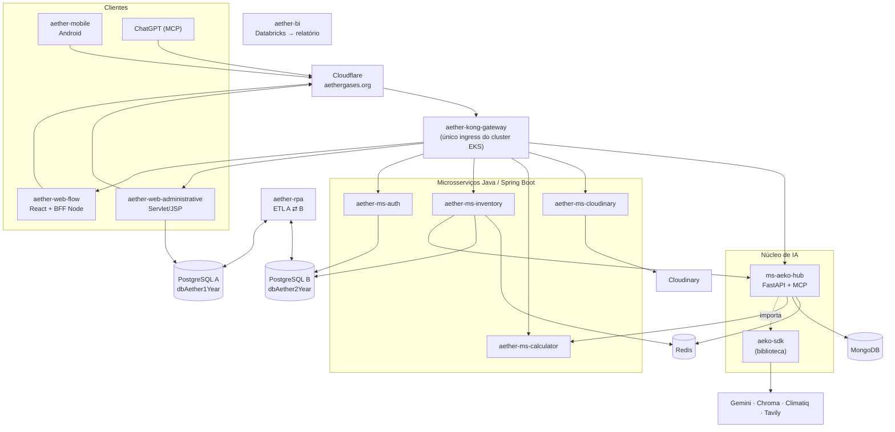

# Aether

> Medir, entender e reduzir as emissões de gases de efeito estufa (GEE) da indústria, com apoio de IA.

O Aether nasceu em 2026 de um projeto interdisciplinar do Instituto J&F. Conversamos com responsáveis por sustentabilidade de empresas do Grupo J&F e confirmamos a necessidade de uma ferramenta simples para a transição rumo a práticas mais sustentáveis, alinhada ao **ODS 12 (Consumo e Produção Responsáveis)**.

## O problema

Para reduzir emissões, a empresa primeiro precisa medi-las. No Brasil, a medição segue o **GHG Protocol**, e no Paraná o **Selo Clima Paraná** (SEDEST) exige o envio do inventário em uma planilha de inscrição. Hoje esse processo é manual: os dados ficam espalhados em planilhas e são difíceis de consolidar entre unidades e de comparar de um ano para o outro.

## O que o Aether faz

- **Inventário de GEE**: o analista envia a planilha da unidade (app ou web) e acompanha o processamento. O banco foi modelado para ter compatibilidade total com o GHG Protocol (escopos 1, 2 e 3, categorias e os 7 gases de Quioto) e com a planilha do Selo Clima Paraná.
- **Revisão**: o gestor aprova ou rejeita os inventários pendentes, com notificações por e-mail e push.
- **Aeko, a IA do Aether**: um sistema multiagente lê o inventário, analisa poluentes, sugere gases verdes e escreve um plano de melhoria. Também há um chatbot para dúvidas de ESG e acesso via ChatGPT (MCP).
- **Calculadoras**: ROI, payback, previsão de redução de emissões e de redução de custos.
- **Painel e BI**: indicadores de emissões e reduções por unidade e um relatório gerencial atualizado automaticamente.
- **Administração**: cadastro de empresas, unidades, setores, funcionários, planos e permissões.

## Como as peças se encaixam

Dois bancos PostgreSQL convivem de propósito: o **A** (`dbAether1Year`, modelo do 1º ano) é escrito pelo sistema administrativo, e o **B** (`dbAether2Year`, modelo normalizado do 2º ano) é o dos microsserviços. O `aether-rpa` mantém os dois sincronizados.

## Repositórios

### Plataforma e infraestrutura

| Repositório | Papel | Stack |
| --- | --- | --- |
| [aether-kong-gateway](https://github.com/AetherGases/aether-kong-gateway) | Único ingress público. Roteia `/api/*`, `/hub`, `/dashboard` e `/` para os serviços internos | Kong 3.9 (declarativo, sem banco) |
| [aether-infra](https://github.com/AetherGases/aether-infra) | Segredos, variáveis e provisionamento do EKS (privado) | GitHub Actions, PowerShell, AWS |
| [.github](https://github.com/AetherGases/.github) | Este perfil e o workflow reutilizável de deploy no EKS | GitHub Actions |
| [aether-toolskit](https://github.com/AetherGases/aether-toolskit) | Ambiente local (Postgres, Mongo, Redis) e scripts SQL do banco | Docker Compose, PL/pgSQL |

### Backend

| Repositório | Papel | Stack |
| --- | --- | --- |
| [aether-ms-auth](https://github.com/AetherGases/aether-ms-auth) | Login, JWT, perfil, notificações e suporte | Java 21, Spring Boot |
| [aether-ms-inventory](https://github.com/AetherGases/aether-ms-inventory) | Inventário de GEE: envio, análise, aprovação e geração de planilha | Java 21, Spring Boot, Redis |
| [aether-ms-calculator](https://github.com/AetherGases/aether-ms-calculator) | ROI, payback, gases e previsões de redução | Java 21, Spring Boot |
| [aether-ms-cloudinary](https://github.com/AetherGases/aether-ms-cloudinary) | Assinatura de upload de arquivos no Cloudinary | Java 21, Spring Boot |
| [ms-aeko-hub](https://github.com/AetherGases/ms-aeko-hub) | API HTTP e servidor MCP entre os apps e a IA | Python 3.11, FastAPI |
| [aeko-sdk](https://github.com/AetherGases/aeko-sdk) | Agentes, RAG, memória e análise de inventário (biblioteca no PyPI como `aeko`) | Python 3.11, LangGraph |
| [aether-rpa](https://github.com/AetherGases/aether-rpa) | ETL bidirecional entre os dois bancos PostgreSQL | Python 3.11 |

### Clientes

| Repositório | Papel | Stack |
| --- | --- | --- |
| [aether-web-flow](https://github.com/AetherGases/aether-web-flow) | Portal web em `/dashboard` e o BFF (`aether-web-bff`) | React 19, TypeScript, Vite, Node/Express |
| [aether-web-administrative](https://github.com/AetherGases/aether-web-administrative) | Sistema administrativo (CRUD) | Java 25, Servlet/JSP, Tomcat 11 |
| [aether-mobile](https://github.com/AetherGases/aether-mobile) | App Android | Kotlin, Jetpack Compose, Koin |

### Dados e documentação

| Repositório | Papel | Stack |
| --- | --- | --- |
| [aether-bi](https://github.com/AetherGases/aether-bi) | Pipeline Bronze/Silver/Gold no Databricks e relatório gerencial publicado no GitHub Pages | Databricks, Python |
| [aether-docs](https://github.com/AetherGases/aether-docs) | Pesquisa, UX, diagramas, contratos de API e requisitos | Markdown, PDF, draw.io |

> **Arquivado:** `aether-core-api` era a API monolítica do projeto. Foi substituída pelos microsserviços Java e pelo hub de IA.

## Fluxo principal: do envio do inventário ao plano de melhoria

1. O analista envia a planilha pelo app ou pelo portal. O arquivo vai direto ao Cloudinary com uma assinatura emitida pelo `aether-ms-cloudinary`.
2. O `aether-ms-inventory` grava o inventário com status `PROCESSING` e o enfileira no Redis.
3. Um worker do inventário chama o `ms-aeko-hub`, que usa o `aeko-sdk` para extrair as emissões e escrever o plano de melhoria.
4. O inventário volta com as emissões extraídas e fica pendente de revisão. O gestor aprova ou rejeita no app.
5. Indicadores e relatórios passam a refletir o inventário aprovado.

## Como contribuir

- **Branches**: nos repositórios com `develop`, ela é a branch padrão. Crie `feature/<n>`, `fix/<nome>` ou `docs/<nome>` a partir dela e abra a PR de volta. Os repositórios `aether-rpa`, `aether-bi`, `aether-docs`, `aether-infra` e `aether-kong-gateway` usam `main` como branch padrão.
- **Commits**: [Conventional Commits](https://www.conventionalcommits.org/) (`feat:`, `fix:`, `docs:`, `refactor:`...).
- **Pull requests**: cada repositório tem um template com checklist. Preencha, especialmente a seção de possíveis falhas.
- **Testes**: os repositórios de código rodam os testes no CI. O deploy só prossegue se os checks do commit passaram.
- **Segredos**: nunca no repositório. Eles vivem em secrets e variables da organização (ver `aether-infra`).

## Deploy

Todos os serviços são implantados no mesmo cluster EKS (`aether-prd`, namespace `aether`) pelo workflow reutilizável deste repositório, [`deploy-eks.yml`](.github/workflows/deploy-eks.yml). Cada repositório tem um `deploy.yml` mínimo que o chama quando uma **release é publicada**. O workflow roda o gate de CI, constrói a imagem, envia ao ECR e cria ou atualiza o Deployment. Há um template em [`workflow-templates`](workflow-templates/).

Ordem de deploy de um ambiente novo: `ms-auth`, `ms-inventory`, `ms-cloudinary`, `ms-calculator`, `ms-aeko-hub`, `aether-rpa`, `web-administrative`, `kong-gateway`, `web-flow`.

## Rodando tudo localmente

O [aether-toolskit](https://github.com/AetherGases/aether-toolskit) sobe PostgreSQL, MongoDB e Redis já com o schema e os dados iniciais. Em seguida suba cada serviço seguindo o README do repositório.

## Tecnologias utilizadas

  
  
  
  
  
  
  
  
  
  
  
  
  

## Autores

O projeto foi desenvolvido por duas equipes.

Os alunos do 1º ano idealizaram o projeto e desenvolveram parte dele:

- Caio Campelo Rocha
- Lais Casteluci Almeida
- Luiz Miguel Félix Ferreira
- Miguel Juvillar de Souza Pinheiro
- Rafaella Rosa Silva Santos

Os alunos do 2º ano desenvolveram o restante:

- Caio Marcos Ambrósio Maciel
- Eduardo Costa Amex Macal
- Fernanda Nogueira Nagata
- Isabelly Vila Silva da Hora
- Pedro Henrique Casarini Alves
- Vinícius Villas Boas

## Acesso ao Aether

Para usar o Aether, a empresa assina um dos planos de serviço. Depois da contratação, os funcionários que inserem dados, analisam relatórios e os gerentes de sustentabilidade acessam a plataforma, com permissões personalizadas para cada indústria.

## Suporte

Escreva para [grupoaetherjef@gmail.com](mailto:grupoaetherjef@gmail.com).
