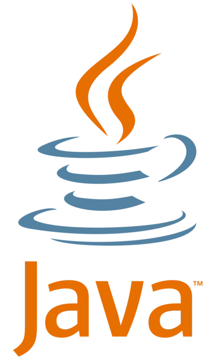
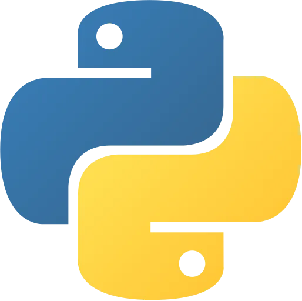

# Aether

O Aether nasceu em 2026, como resultado de um projeto interdisciplinar escolar desenvolvido no Instituto J&F. Nesse projeto, tivemos contato direto com responsáveis de sustentabilidade das empresas do Grupo J&F e realizamos diversas pesquisas que comprovaram a necessidade de um novo aplicativo com foco na sustenabilidade. 

Nosso aplicativo é voltado para auxiliar empresas na transição rumo a práticas mais sustentáveis, alinhadas ao Objetivo de Desenvolvimento Sustentável 12 (Consumo e Produção Responsável). Seu principal propósito é reduzir a emissão de gases poluentes, como o CO2 e metano, por meio do incentivo  ao uso de alternativas verdes como o hidrogênio e conscientização corporativa sobre os benefícios ambientais e econômicos da sustentabilidade.

## Tecnologias utilizadas

  
  
  
  
  
  
  
  
  
  
  
  
  

## Autores

O projeto foi desenvolvido por duas equipes principais:

Os alunos do 1º ano que idealizaram o projeto e desenvolveram parte do projeto:
- Caio Campelo Rocha;
- Lais Casteluci Almeida;
- Luiz Miguel Félix Ferreira;
- Miguel Juvillar de Souza Pinheiro;
- Rafaella Rosa Silva Santos.

E o 2º ano que desenvolveram o restante do projeto:
- Caio Marcos Ambrósio Maciel;
- Eduardo Costa Amex Macal;
- Fernanda Nogueira Nagata;
- Isabelly Vila Silva da Hora;
- Pedro Henrique Casarini Alves;
- Vinícius Vilas Boas.

## Repositórios

### [aether-kong-gateway](https://github.com/AetherGases/aether-kong-gateway)

Único ingress público do cluster EKS (`namespace aether`). O Kong recebe o tráfego proxied pelo Cloudflare e encaminha `/api/auth`, `/api/inventories`, `/api/calculator`, `/api/cloudinary`, `/hub`, `/dashboard` e `/` para os serviços internos.

### [aether-ms-auth](https://github.com/AetherGases/aether-ms-auth)

Microsserviço Java 21 Spring Boot de identidade. Emite JWT, mantém perfil e dispara e-mail pelo Brevo. Persiste no PostgreSQL B (`dbAether2Year`).

### [aether-ms-inventory](https://github.com/AetherGases/aether-ms-inventory)

Dono do inventário de GEE. Grava o registro no PostgreSQL B com status `PROCESSING`, enfileira `input_inventories:{id}` no Redis e, depois da análise do hub, persiste as emissões extraídas.

### [aether-ms-calculator](https://github.com/AetherGases/aether-ms-calculator)

API Java de ROI, payback e gases. O hub chama este serviço internamente (`INVESTMENT_MS_BASE_URL`) com `authentication-key`.

### [aether-ms-cloudinary](https://github.com/AetherGases/aether-ms-cloudinary)

API Java só de mídia. Assina e envia arquivos para o Cloudinary. Não tem banco próprio.

### [ms-aeko-hub](https://github.com/AetherGases/ms-aeko-hub)

Gateway HTTP e MCP FastAPI entre os apps e o núcleo de IA. Expõe sessões, `analyze_inventory`, `POST /ai/report` e ChatGPT MCP em `/hub/ai/mcp`. Usa Mongo, Redis (tickets `aeko:inventory-upload`) e chama os MS Java com chave interna.

### [aeko-sdk](https://github.com/AetherGases/aeko-sdk)

Biblioteca Python de agentes, RAG, memória e `AekoInventoryAnalyzer`. Não é um serviço: o hub importa o SDK e fala com Gemini, Chroma Cloud, Climatiq e Tavily.

### [aether-rpa](https://github.com/AetherGases/aether-rpa)

Worker Python de ETL bidirecional. Consome `rpa_outbox` com `LISTEN/NOTIFY aether_rpa` e replica o cadastro entre PostgreSQL A (`dbAether1Year`) e PostgreSQL B.

### [aether-web-administrative](https://github.com/AetherGases/aether-web-administrative)

Servlet/JSP de CRUD operacional. Escreve o cadastro no PostgreSQL A, que o RPA replica para o banco dos microsserviços.

### [aether-web-flow](https://github.com/AetherGases/aether-web-flow)

Portal TypeScript publicado em `/dashboard`. É o cliente web do fluxo operacional e da IA, atrás do Kong.

### [aether-mobile](https://github.com/AetherGases/aether-mobile)

App Kotlin. Envia inventários e acompanha a análise pelo mesmo ingress Kong.

### [aether-bi](https://github.com/AetherGases/aether-bi)

Business Intelligence no Databricks (Bronze, Silver e Gold). Calcula indicadores de emissões e reduções e atualiza o relatório gerencial.

### [aether-toolskit](https://github.com/AetherGases/aether-toolskit)

Ambiente local do ecossistema: Compose com PostgreSQL, Mongo, Redis, variáveis e scripts para subir os serviços juntos.

### [aether-infra](https://github.com/AetherGases/aether-infra)

Secrets, variáveis de ambiente e ordem de deploy no EKS. Define o namespace `aether` e a lista em `config/services.txt`.

### [aether-docs](https://github.com/AetherGases/aether-docs)

Documentação central do projeto: pesquisas, UX, arquitetura, diagramas, requisitos e materiais técnicos.

### Arquivado

[aether-core-api](https://github.com/AetherGases/aether-core-api) era a API monolítica anterior. Foi substituída pelos microsserviços Java e pelo hub.

## Acesso ao Aether

Para usar o aplicativo Aether, a empresa deve assinar um dos planos de serviço. Após a contratação, todos os funcionários requeridos para a inserção de dados, análise de relatórios e gerentes de sustentabilidade poderão acessar a plataforma, que conterá com permissionamento personalizado para cada indústria.

## Suporte

Para suporte, mande um email para grupoaetherjef@gmail.com
